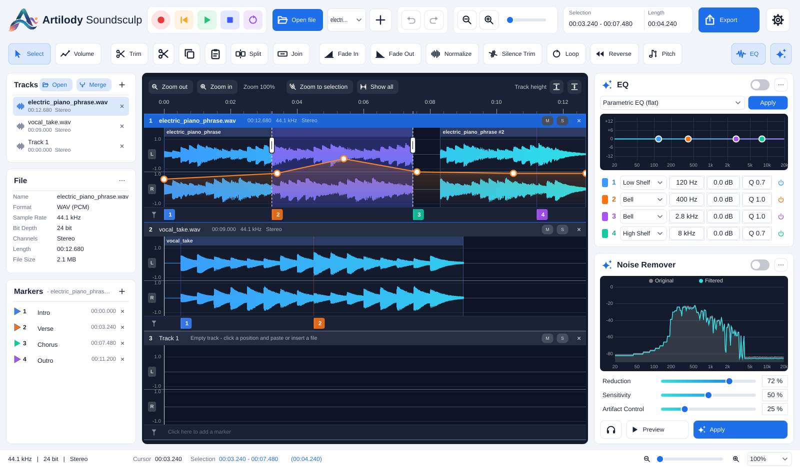

# Artilody Soundsculp

A simple multi-track audio editor for Windows, macOS and Linux, built with C++ and [JUCE](https://juce.com).  
*En simpel lydredigerings-app med flere spor til Windows, macOS og Linux, bygget med C++ og JUCE.*



## Features
- Several audio tracks below each other on a shared timeline – all tracks play together, with Mute/Solo per track
- Audacity-style clips: cut/delete leave gaps, split, join, drag clips around and onto other tracks
- Create empty tracks, insert files, record from the microphone, merge tracks into one
- Trim, cut/copy/paste, fade in/out, normalize, silence trim, loop, reverse
- Pitch shift without changing the speed (phase vocoder)
- Parametric 4-band EQ (live preview + apply) and spectral noise remover with spectrum display
- Per-track volume line with mouse-editable points
- Numbered, coloured markers per track with text in the Markers panel
- Export dialog: current track, selection or all tracks mixed; export runs in the background
- Zoom bar, track height, undo/redo; English user interface (Danish under Settings → Language)

## File formats
| | Formats |
|---|---|
| **Open** | WAV, AIFF, FLAC, Ogg Vorbis and MP3 on all systems; additionally M4A / AAC / CAF on macOS |
| **Export** | WAV (16-bit, 24-bit, 32-bit float), AIFF (24-bit), FLAC (16/24-bit, lossless), MP3 (320 / 192 kbps), Ogg Vorbis (192 kbps) |

MP3 export uses the [LAME](https://lame.sourceforge.io) encoder, which is compiled into the app from the sources in
[`third_party/lame`](third_party/lame); everything else is handled by JUCE (on macOS M4A/AAC/CAF via Core Audio).
No external programs are needed or bundled.
Opus files cannot be opened, and M4A files only on macOS.

## Download
Installers are on the [Releases](https://github.com/shenphenchoedron-hue/Artilody-Soundsculp/releases/latest) page:

| System | File |
|---|---|
| Windows 10/11 (64-bit) | `ArtilodySoundsculp-<version>-Windows-Setup.exe` or `…-Windows-Portable.zip` |
| macOS 11 Big Sur or later (Intel + Apple Silicon) | `ArtilodySoundsculp-<version>-macOS-Universal.dmg` |
| Debian 12+ | `artilody-soundsculp_<version>_debian-12_amd64.deb` |
| Ubuntu 22.04 / 24.04 | `artilody-soundsculp_<version>_ubuntu-22.04-24.04_amd64.deb` |

User manuals in English and Danish (PDF) are attached to every release and installed with the program.

- **Linux:** `sudo apt install ./artilody-soundsculp_*.deb`
- **macOS:** the app is not notarised. On macOS 15 and later, open it once, then go to
  **System Settings → Privacy & Security** and click **Open Anyway** (on macOS 11–14: right-click the app → Open).
  Alternatively: `xattr -dr com.apple.quarantine "/Applications/Artilody Soundsculp.app"`.

## Building
Requirements: CMake ≥ 3.22 and a C++17 compiler (GCC/Clang, Xcode, or Visual Studio 2019/2022).
JUCE 8.0.4 is downloaded automatically (or pass `-DJUCE_DIR=/path/to/JUCE` to use a local checkout).

```sh
# Linux dependencies (Debian/Ubuntu)
sudo apt install cmake g++ libasound2-dev libjack-jackd2-dev libfreetype-dev libfontconfig1-dev \
  libx11-dev libxcomposite-dev libxcursor-dev libxext-dev libxinerama-dev libxrandr-dev libxrender-dev libgl1-mesa-dev

cmake -B build -DCMAKE_BUILD_TYPE=Release
cmake --build build -j
./build/ArtilodySoundsculp_artefacts/Release/Artilody\ Soundsculp
```

- **macOS** (deployment target 11.0): `cmake -B build -G Xcode -DCMAKE_OSX_ARCHITECTURES="arm64;x86_64"`
  then `cmake --build build --config Release`.
- **Windows**: `cmake -B build -A x64` then `cmake --build build --config Release`.
  The MSVC runtime is linked statically, so no Visual C++ Redistributable is needed.
- **Linux .deb**: install `dpkg-dev` as well, then `cd build && cpack -G DEB`.

Self tests: run the program with `--selftest` (DSP + file formats) or `--uitest` (editing workflow).  
Manuals: `tools/build_manuals.sh` renders `docs/manual/*.html` to `docs/pdf/*.pdf` with headless Chrome/Chromium
(set `CHROME=/path/to/chrome` if it is not found automatically).

Pushing a tag `v<version>` (matching the version in `CMakeLists.txt`) builds all installers on GitHub Actions and
publishes them as a release with the text from [docs/RELEASE_NOTES.md](docs/RELEASE_NOTES.md).

## License
Artilody Soundsculp is licensed under the **GPL-3.0** – see [LICENSE](LICENSE).

- It is built with **JUCE 8**, which is dual-licensed AGPLv3 / commercial; this project uses JUCE under the
  **AGPLv3**. The application binary is therefore a combined work of GPL-3.0 and AGPL-3.0 code, which both
  licenses permit (section 13 of the GPLv3 and the AGPLv3); the AGPLv3 terms apply to the JUCE part and to the
  combined work as a whole.
- JUCE includes third-party libraries compiled into the app (FLAC, Ogg Vorbis, IJG jpeglib, libpng, zlib,
  HarfBuzz, SheenBidi) under permissive licenses. MP3 files are decoded with JUCE's own MP3 decoder.
- MP3 export uses **LAME 3.100** (LGPL-2.0-or-later), included unmodified in [third_party/lame](third_party/lame).

Details and all license texts: [THIRD_PARTY_NOTICES.md](THIRD_PARTY_NOTICES.md) and [packaging/licenses](packaging/licenses).
